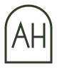
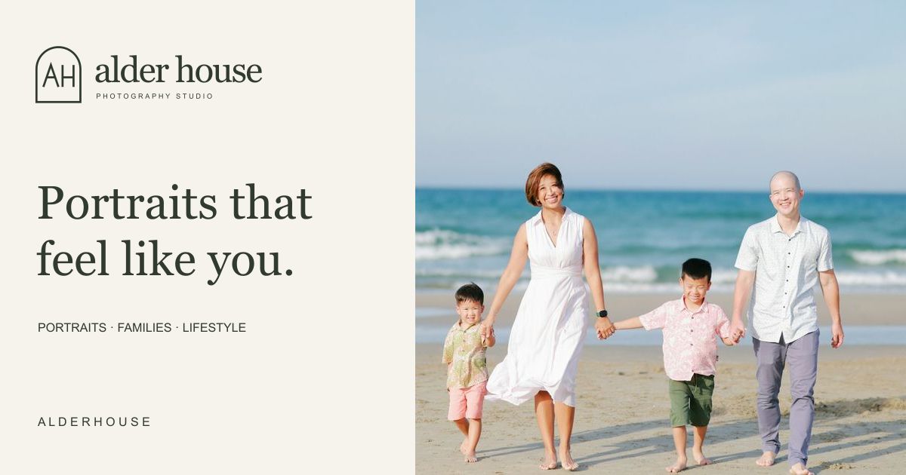

# <picture><source media="(prefers-color-scheme: dark)" srcset="public/brand/mark-light.svg"></picture> Alder House



[](https://github.com/nicholasadamou/alder-house/actions/workflows/ci.yml)


[](LICENSE)

A fictional photography studio for portraits, families, brands, and celebrations.
The editorial site includes portfolio stories, six planning tools, and keyboard
search. Sanity can manage the studio content; the demo inquiry sends no personal
data.

[Explore Alder House](https://alder-house.vercel.app)

## Getting started

```sh
flox activate
bun install --frozen-lockfile
bun run dev
```

## Documentation

- [Visitor guide](docs/visitor-guide.md): portfolio stories, session guides, and the demo inquiry.
- [Getting started and local verification](docs/development.md): Flox, previews, builds, and browser checks.
- [CMS publishing](docs/cms.md): connect a Sanity project and publish content.
- [Architecture](docs/architecture.md): site, CMS, and discovery responsibilities.
- [Brand assets and photography](docs/assets.md): identity files, fonts, and image credits.
- [Deployment](docs/vercel.md): Vercel configuration and production builds.

## Local verification

Run `bun run verify` inside Flox after installing Chromium as described in
[development](docs/development.md). The gate checks formatting, documentation,
types, workflows, website and Studio builds, browser journeys, and accessibility.
The pre-commit hook and GitHub Actions use the same checks.

## License

Copyright © 2026 Nicholas Adamou.

The project is licensed under [PolyForm Shield License 1.0.0](LICENSE), with Nicholas Adamou as
the holder.

Third-party photographs retain their [separate terms and credits](docs/assets.md).
